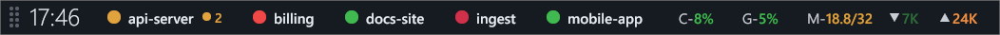

# SessionLights

One coloured light per [Claude Code](https://code.claude.com) session, always in view, so you can see which session is waiting on you without cycling through terminal tabs. On Windows it is a slim always-on-top strip with a clock and system stats; on Linux it is a stats bar in the top panel.



| Dot | Meaning |
|---|---|
| amber | busy: a turn is running |
| green | idle: finished, nothing wanted |
| red | waiting on you (permission prompt or question); back to amber once the approved tool has run |
| deep red | the turn failed on an API error: needs attention |
| small amber dot + number | that many sub-agents running |

Hover a session for its full name, its state in words and the detail (the permission it wants, the error).

## Install

SessionLights is a Claude Code [plugin](https://code.claude.com/docs/en/plugins), and this repo is its marketplace. Inside Claude Code:

```
/plugin marketplace add Carltk/sessionlights
/plugin install sessionlights@sessionlights
```

On Claude Code 2.1.275 or later, `/plugin install sessionlights --marketplace Carltk/sessionlights` does both in one step. Then type `/lights` to start the strip (Windows) or the bar (Linux).

It runs on **Windows** and **x86-64 Linux**. On arm64 or macOS the hook cannot run, so don't install it there. Windows needs nothing else: no Go, no runtime. On Linux the bar needs a StatusNotifierItem host in the panel: Ubuntu's GNOME and KDE have one, while plain GNOME needs the AppIndicator extension.

The plugin gives you:

- **The hook.** Every session reports its state from then on. Sessions that were already open start reporting once they are restarted.
- **The `/lights` skill.** Type `/lights`, or ask Claude to "show the session lights". On Windows it starts a strip on the desktop you are on. On Linux it runs `sessionlights install` (once is enough, but it is safe to repeat) and starts the bar.
- **The binaries**: `bin/sessionlights.exe` for Windows and `bin/sessionlights` for Linux. Each is both the viewer and the hook.

To start the strip at login on Windows, put a shortcut to the plugin's `bin/sessionlights.exe` in `shell:startup`. The plugin's folder is per version, so make the shortcut again after a plugin update. On Linux, `/lights` sets up the autostart for you: it copies the binary out of the plugin cache to `~/.local/share/sessionlights/` and points autostart there, so an update does not break it, and each `/lights` refreshes the copy. `/plugin` shows where the plugin is installed.

## The Windows strip

From left to right: a grip, the clock, a blue badge with the virtual desktop's number (and its Task View name, if you gave it one), the sessions, then the stats.

- **Click** a session to bring its terminal to the front. If the terminal is on another virtual desktop, Windows switches to it.
- **Drag** the grip on the left edge to move the strip. Let go near the top of the screen and it snaps there.
- **Drag** a session sideways to reorder it. Sessions are grouped by the virtual desktop their terminal is on, in Task View order, and the order is shared by every strip.
- **Right-click** to close.
- A **ring** marks sessions whose terminal is on the desktop you are looking at.

Each session is labelled with its title if you gave it one with Claude Code's `/rename` (or `claude --name`), otherwise with the folder it runs in, cut to about 10 characters.

**Stats** sit on the right, each in a colour band so you read the load before the number:

| Stat | Source | Colour |
|---|---|---|
| `C` CPU | `GetSystemTimes` deltas | green < 25% · yellow-green < 50% · amber < 75% · red |
| `G` GPU | the busiest engine in the `GPU Engine` performance counters, sampled every 10 s | as CPU |
| `M` memory | used / total GB from `GlobalMemoryStatusEx` | as CPU, by share of total |
| ▼ ▲ | bytes/s over physical network adapters only | download greens brighten with speed; upload runs orange to red |

The strip redraws only when something it shows changes. It uses about 0.5% of one CPU core and around 100 MB of RAM.

**Pinned or per desktop.** By default one strip runs per virtual desktop, so you start one on each desktop where you want it. With `-vd` (below), one strip is pinned to every desktop, follows you, and keeps one position everywhere. Either way a second strip that would duplicate one exits by itself.

## The Linux bar

On Linux the same binary is a small system-stats bar in the spirit of [ULBar](https://ulbar.io): CPU, GPU, memory and network as colour-banded numbers, with one item per live session to their left. Wayland lets no app keep a floating window on top, so it lives in the top panel as StatusNotifierItems.

Each session's item is a short name in its state colour. **Double-click it to jump to that session's terminal** (Ubuntu's AppIndicator host only passes a click on as a double-click). Wayland lets no ordinary app raise another app's window, so `install` adds a ~70-line GNOME Shell extension (`gnome-extension/`) whose only job is raising the window that owns a process; it takes effect after you next log in. In kitty a double-click also picks the session's tab, provided kitty has a remote-control socket: add `listen_on unix:@kitty` to `kitty.conf` and restart kitty.

| Stat | Source |
|---|---|
| CPU | `/proc/stat` deltas |
| GPU | DRM fdinfo engine time, busiest engine (Intel, AMD, any driver that reports it); no root |
| MEM | `MemTotal − MemAvailable` |
| ↓ ↑ | `/proc/net/dev`, physical interfaces only |

The colours match the Windows strip. No subprocesses, no network calls: everything is read from `/proc` and `/sys`.

Without the plugin:

```
go build -o ~/.local/bin/sessionlights .
sessionlights install        # once: shell extension and autostart (log out and in after)
sessionlights &              # the bar
sessionlights -once 2s       # print one sample and exit
sessionlights -png bar.png   # render the bar once to a PNG
sessionlights uninstall      # remove the extension, autostart and any copied binary
```

## Where the lights come from

The viewer only displays sessions. The plugin's hook, `sessionlights hook`, writes one JSON file per session and updates it from the events Claude Code passes on stdin:

| Event | Light |
|---|---|
| `SessionStart` | idle |
| `UserPromptSubmit` | busy (tool failure count reset) |
| `Notification` asking for permission or input | waiting |
| `PostToolUse` | back to busy after a permission was granted |
| `PostToolUseFailure` | busy, with "N tool failures" as detail |
| `SubagentStart` / `SubagentStop` | adds / removes one sub-agent marker |
| `Stop` | idle |
| `StopFailure` | failed, with the error as detail |
| `SessionEnd` | file removed |

The hook always exits 0 and stays silent, so a broken light can never block a session. Any other producer that writes the same format works too.

Hook and viewer both use `~/.claude/session-lights/` (inside `CLAUDE_CONFIG_DIR` if you set it). Set `SESSIONLIGHTS_DIR` to move the hook's folder, and pass the viewer `-dir <folder>` to match. Each file looks like this:

```json
{
  "sessionId": "0f8e2c1a-5b7d-4e3f-9a61-2d4c8b0e7f13",
  "name": "My project",
  "cwd": "C:\\code\\my-project",
  "state": "waiting",
  "since": "2026-09-30T10:19:37+10:00",
  "detail": "Claude needs your permission to use Bash",
  "window": { "hwnd": 66466, "pid": 11740 },
  "pid": 2196,
  "pidStart": 1790724369056
}
```

| Field | Required | Meaning |
|---|---|---|
| `sessionId` | yes | stable id; one file per session |
| `name` | yes | shown cut to about 10 characters at a word end; in full on hover |
| `state` | yes | `busy`, `idle`, `waiting` or `failed`; anything else shows a grey dot |
| `since` | no | RFC 3339 time the state began |
| `detail` | no | shown on hover, cut to 80 characters |
| `window.hwnd` | no | the terminal's top-level window handle; enables click-to-focus and the ring |
| `pid` | no | the `claude` process; its death hides the session |
| `pidStart` | no | that process's start time in unix ms, so a reused PID is not mistaken for the session |

Running sub-agents are not a field: the hook keeps one empty file per agent id in `<session>.agents/` beside the light, and the viewer counts them, so agents started in parallel cannot lose a count. When a turn ends with no agent-capable background task still running, the hook clears any markers a missed `SubagentStop` left behind.

A file without a `pid` is hidden once it hasn't been modified for 30 minutes. Files are re-read as soon as they change, and a half-written file is skipped until the next write.

Saved positions go next to the lights folder, as `session-lights-go-pinned.json` (pinned) or `session-lights-go-<desktop-id>.json`, and the dragged order as `session-lights-order.json`.

## Flags

- `-dir <folder>` reads light files from another folder (default `~/.claude/session-lights`).
- `-vd <VirtualDesktop.exe>` (Windows) pins one strip to every desktop and makes clicking a session switch desktop first. It needs [MScholtes/VirtualDesktop](https://github.com/MScholtes/VirtualDesktop): `VirtualDesktop.exe` on Windows 10, `VirtualDesktop11.exe` on Windows 11, `VirtualDesktop11-24H2.exe` on 24H2 and later.
- `-once <duration>` prints one stats sample taken over that interval and exits.
- `-log <file>` writes a debug log.

## Build it yourself

You need [Go](https://go.dev/dl/) 1.26 or later. No C compiler: both builds are pure Go.

```
git clone https://github.com/Carltk/sessionlights
cd sessionlights
GOARCH=amd64 CGO_ENABLED=0 go build -trimpath -ldflags="-H windowsgui -s -w" -o bin/sessionlights.exe .
GOOS=linux GOARCH=amd64 CGO_ENABLED=0 go build -trimpath -ldflags="-s -w" -o bin/sessionlights .
```

Those commands are for Git Bash or a Linux shell. In PowerShell, set `$env:GOARCH="amd64"; $env:CGO_ENABLED="0"` first. `-H windowsgui` stops a console window opening alongside the strip, and when the exe runs as a hook. `-trimpath` keeps your own folder names out of the binary. Close any running strip before rebuilding, because Windows won't replace a running exe.

To try your build as the plugin, point Claude Code at the folder: `claude --plugin-dir <path to the clone>` for one session, or `/plugin marketplace add <path to the clone>` to install it.

The hook command in `hooks/hooks.json` names `bin/sessionlights` with no extension and passes its argument in `args`, so Claude Code starts it directly rather than through a shell. Windows then runs the `.exe` beside it, and Linux runs the extension-less binary.

## Notes for hacking on it

- `lights.go` is the platform-neutral view model; `stats.go` holds the stat bands and formatting. Both are covered by `go test`.
- `hook.go` is the producer (`sessionlights hook`), covered by `go test`; `hook_windows.go` finds the session's `claude.exe` and the terminal window hosting its console, and `proc_linux.go` does the same from `/proc`.
- Windows: `ui.go` is the Gio layout, `main.go` wires it together, `win_windows.go` is the window glue (process checks, `IVirtualDesktopManager`, focusing, positioning), `stats_windows.go` samples the stats and `tooltip_windows.go` is the hover tip.
- Linux: `main_linux.go` runs the bar, `tray_linux.go` is the StatusNotifierItem, `render.go` draws the segments, `stats_linux.go` samples `/proc` and `/sys`, and `install_linux.go` is `install`/`uninstall`.
- `tools/icon/` draws the plugin icon.
- Build with `GOARCH=amd64` spelled out if your environment might set another architecture; a 32-bit Windows build fails at runtime.

Gio v0.10.3 on Windows has a few traps, worked around here:

- `app.TopMost(true)` stops the window going top-most at all, so top-most is set on the window handle instead.
- Calling a message-sending Win32 function from the `w.Event()` loop deadlocks, because the window thread is waiting on that loop. Such calls go through `go w.Run(...)`.
- Only the window thread is DPI-aware, so screen coordinates are read and used inside `w.Run`.
- Windows will not shrink an overlapped window below about 47 px, so the strip resizes itself as a popup window.
- A drag area on top of clickable content swallows the clicks, which is why the strip drags from a grip.

## Licence

MIT. See [LICENSE](LICENSE).
